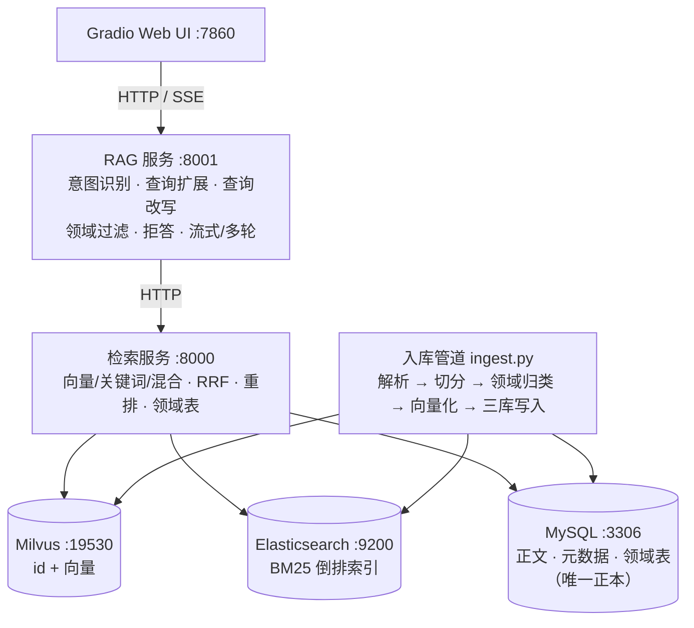
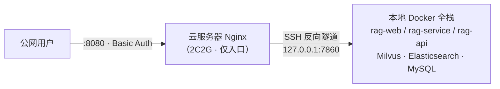

# 智能知识库问答系统（RAG）

基于检索增强生成的多格式文档问答系统：支持 PDF（含扫描版 OCR）/ Word / Markdown / TXT 增量入库，
向量 + 关键词混合检索、RRF 融合与重排，意图识别与领域路由，全链路可评测。

> 从零实现（不依赖 LangChain / LlamaIndex），每一层的设计取舍都有对应实验数据支撑。

## 核心能力

- **多格式增量入库**：PDF（扫描版自动降级 `qwen-vl-ocr` 识别表格与版面）/ Word / Markdown / TXT；
  文件级 sha256 幂等（重复入库自动跳过、内容更新自动替换），新文档入库即可检索
- **混合检索**：Milvus 向量（IVF_SQ8）+ Elasticsearch BM25（jieba 预分词），RRF 排序融合 + `gte-rerank-v2` 重排
- **RAG 服务**：意图识别（领域路由）、查询扩展、多轮查询改写、领域过滤、低置信拒答、SSE 流式输出
- **数据驱动领域路由**：领域表 + 入库时 LLM 自动归类——新增领域文档无需修改任何代码
- **评测体系**：反查法评测集（33 可答 + 10 陷阱）、LLM-as-judge 判定与判分、拒答阈值校准
- **Web 界面**：Gradio 聊天页（流式回答 + 引用来源面板 + 参数可调）

## 系统架构



**分层原则：MySQL 是唯一正本，Milvus 与 Elasticsearch 都是可随时重建的派生索引。**
重建工具 `rebuild_indexes.py` 可分别重建两个索引；正文按 id 从 MySQL 回表获取。

## 部署架构（云端网关 + 隧道回源）

生产部署采用"轻量网关 + 本地算力回源"方案：全栈运行在本地 Docker，云服务器仅承担公网入口。



为什么这样部署：完整栈常驻内存约 2.7G，超出入门级云实例的承载能力，而本地机器算力充裕。
于是云端只做三件事——反向代理、访问鉴权、隧道落点，其余全部回源本地。

- **公网入口**：Nginx 反代（SSE 专用参数：关闭缓冲 + 长超时）+ Basic Auth 访问保护（防 API 额度滥用）
- **隧道回源**：本地主动建立 SSH 反向隧道（家宽无需公网 IP），断线 5 秒自动重连，休眠唤醒自愈
- **一键启停**：`deploy/start.bat` 自动拉起 Docker 全栈并从云端验证链路；`deploy/stop.bat` 一键下线
- **容器化**：三个应用服务共用一个镜像（根目录 `Dockerfile`），`restart: unless-stopped` 随 Docker 自动恢复

**取舍**：零额外成本实现完整栈上线；代价是演示可用性取决于本地机器开机状态——"按需一键开启"正是为这一约束设计的。

## 快速开始

**前置要求**：Docker Desktop ｜ Python 3.11+ ｜ 一个 MySQL 8 实例 ｜ 阿里云百炼 API Key

```bash
# 1. 启动 Milvus 全家桶 + Elasticsearch
cd stage2-milvus && docker compose up -d

# 2. Python 环境
python -m venv .venv
.venv\Scripts\python.exe -m pip install -r requirements.txt   # Windows

# 3. 配置密钥（模板见 .env.example）
cp .env.example .env    # 填入 DASHSCOPE_API_KEY 与 MYSQL_PASSWORD

# 4. 初始化数据库（建库建表建集合 + 领域表迁移）
python stage2-milvus/02_setup_db.py
python stage2-milvus/03_migrate_domains.py

# 5. 导入知识库（首次为全量导入；之后放入新文件再执行即为增量导入）
python stage2-milvus/ingest.py

# 6. 启动服务（各占一个终端，顺序启动）
python stage2-milvus/api_server.py            # 8000 检索服务
python stage3-rag-service/rag_service.py      # 8001 RAG 服务
python stage3-rag-service/web_ui.py           # 7860 Web 界面
```

访问 `http://127.0.0.1:7860` 开始对话；`http://127.0.0.1:8000/docs` 与 `8001/docs` 为 Swagger 接口文档；
`http://localhost:3000`（Attu）可可视化查看向量数据。

**运行测试**：

```bash
pytest tests/ -v    # 单元测试 + 集成冒烟测试（服务离线时集成用例自动跳过）
```

## 评测成绩

评测集：33 道可答题（从知识库文段反查生成，带参考答案）+ 10 道不可答陷阱题。

| 指标 | 结果 |
|---|---|
| 检索 hit@5（hybrid / rerank，LLM 判定口径） | **100%** |
| 检索 MRR | 0.92 ~ 0.93 |
| 端到端答案质量（LLM 判分，0-10） | **9.8** |
| 拒答率（10 道陷阱题） | **10 / 10** |
| 拒答阈值（校准所得） | t ≈ 0.15（有效区间 [0.136, 0.197]，两类题 100% 可分） |

## 实验矩阵（数据支撑的设计决策）

| 实验 | 方法 | 结论 |
|---|---|---|
| **索引选型** | 真实数据 + 5000 条压力集；FLAT/IVF_FLAT/IVF_SQ8/IVF_PQ/HNSW × L2/IP/COSINE × nlist/nprobe 网格 | 定案 **IVF_SQ8 + nprobe=16**（98% 召回拐点，内存约 1/4）；PQ 召回仅 29% 淘汰；向量归一化使三种度量等价 |
| **切分策略** | 6 配置全量重灌 + 检索评测 | 1024 字符窗口与 30% 重叠**显著有害**；256~500 为质量平台期；维持 500 字符 + 15% 重叠 |
| **上下文条数** | 端到端判分 k=3/4/5/7 | k∈[3,7] 为质量平台期（9.82~9.88，差异在噪声内）；取 **k=4**（同等质量下省约 20% 上下文 token） |
| **性能优化** | 分段计时定位瓶颈 | 检索 19.1s → **4.7s**（两阶段检索 + 修复 `localhost` IPv6 回退问题，见下） |
| **意图识别消融** | 开/关 A/B 对比 | 本语料规模下质量收益为 **0**（hit@5/MRR/拒答率完全一致），成本 +2.3s/题——功能保留为可开关项，价值在领域混杂/更大知识库场景 |

## 设计决策（为什么这么做）

1. **MySQL 正本 + 派生索引分离**：换分词器 / 换索引 / 索引损坏，都可从正本全量重建（重建耗时为秒级、无 API 费用）；
   服务器迁移也不需要搬数据库——重新入库即可。
2. **关键词引擎选独立 Elasticsearch**：中文分词用 jieba 预分词 + whitespace 分析器（两侧对称由代码保证），
   获得词级检索与真实 BM25 分数；优于数据库 LIKE（全表扫描）与 ngram（bigram 无词概念）。
3. **RRF 融合而非分数加权**：只依赖排名、免分数归一化、奖励"两路共识"；k=60 为工业默认值
   （ES 8.8+ / Milvus 2.4+ 原生混合检索内置同款）。加权融合的名下权重失真问题在其对比实验中得到验证。
4. **拒答判断放生成层，阈值信号作辅助**：检索是排序不是筛选（永远返回 top-k）；校准出的阈值
   （t≈0.15）在低置信时向生成 prompt 注入提示，最终是否拒答由 LLM 结合上下文判断——三层防线各司其职。
5. **领域路由数据驱动**：领域存于 `domains` 表并作为 chunk 级元数据；入库时 LLM 通读归类（复用优先、新领域自动落表）；
   服务端 60 秒内自动感知——**新增一个领域不需要改一行代码**（已实测：放入医疗文档自动创建 `medical` 领域并正确路由）。

## 工程札记（真实踩坑三则）

- **供应链风险**：MinIO 官方于 2025-10 删除全部免费 Docker 镜像，本项目使用社区按官方源码重建的镜像继续学习验证。
- **Windows localhost 陷阱**：`localhost` 会先解析到 IPv6 `::1`，对仅监听 IPv4 的本地服务每次调用产生约 2 秒回退等待；
  服务间调用统一使用 `127.0.0.1` 后，检索耗时从 19.1s 降至 4.7s。
- **静默 fallback 的危险**：领域过滤的"命中不足则回退"设计曾掩盖一处映射漏配（过滤静默失效）；
  修复后为回退路径增加了显式日志——**系统不该在无声中变差**。
- **约束是架构的一部分**：部署时连续遇到两个"预期外"——Docker Hub 拉取被限速至 ~10KB/s（经镜像站取得同哈希产物解围）、
  云实例实测内存仅为预期的 1/4——后者直接催生了"网关 + 隧道回源"的部署形态。**环境给的约束，最终都会写进架构里。**

## 项目结构

```
RAG/
├── Dockerfile                       # 应用镜像（检索/RAG/Web 三服务共用）
├── deploy/                          # 上线运维：一键启停脚本（start / stop）
├── stage2-milvus/                   # 向量库与检索层
│   ├── docker-compose.yml           #   Milvus 全家桶（etcd/MinIO/standalone/Attu）+ Elasticsearch + 应用服务
│   ├── store.py                     #   共享数据层：三库连接、分词、哈希、领域表
│   ├── ingest.py                    #   增量入库管道（多格式解析 / OCR 降级 / 领域归类 / 三库写入）
│   ├── query_engine.py              #   四种检索（向量/关键词/混合/重排）+ 两阶段精排
│   ├── api_server.py                #   检索服务 API（8000）
│   ├── rebuild_indexes.py           #   派生索引重建工具
│   ├── 0X_*.py                      #   建库 / 建集合 / 领域表迁移脚本
│   └── documents/                   #   知识库源文件
├── stage3-rag-service/              # RAG 服务层
│   ├── rag_service.py               #   完整版 RAG 服务（8001）
│   ├── web_ui.py                    #   Gradio 聊天界面（7860）
│   ├── build_eval_set.py            #   评测集构建（反查法：文段 → 问题 + 参考答案）
│   ├── eval_rag.py                  #   评测脚本（检索指标 / LLM 判分 / 阈值校准）
│   └── exp_*.py                     #   实验脚本（索引调参 / chunking / top-k）与结果报告
├── tests/                           # 冒烟测试（pytest）
├── requirements.txt
└── .env.example                     # 环境变量模板
```

## 主要接口

| 服务 | 端口 | 端点 |
|---|---|---|
| 检索服务 | 8000 | `POST /search`（四种检索模式）· `POST /rerank` · `GET /domains` · `GET /stats` · `GET /docs` |
| RAG 服务 | 8001 | `POST /chat` · `POST /chat/stream`（SSE）· `POST /chat/with-history`（多轮）· `GET /docs` |
| Web 界面 | 7860 | Gradio 聊天页（流式回答 + 引用来源面板） |

## 路线图

- [x] 服务容器化：应用镜像 + 全栈 compose，一键启停（MySQL 复用宿主机实例）
- [x] 配置外置：连接地址全部环境变量化，适配容器网络
- [ ] 评测扩展：多轮对话评测、拒答阈值随语料增长的再校准
- [ ] 检索优化：查询扩展并行化、embedding 批量合并

## 说明

- 知识库内置文档为公开发布的行业研究报告，仅用于学习演示。
- LLM 相关能力（对话 / 向量化 / 重排 / OCR）均通过阿里云百炼平台调用，需要自行申请 API Key。
